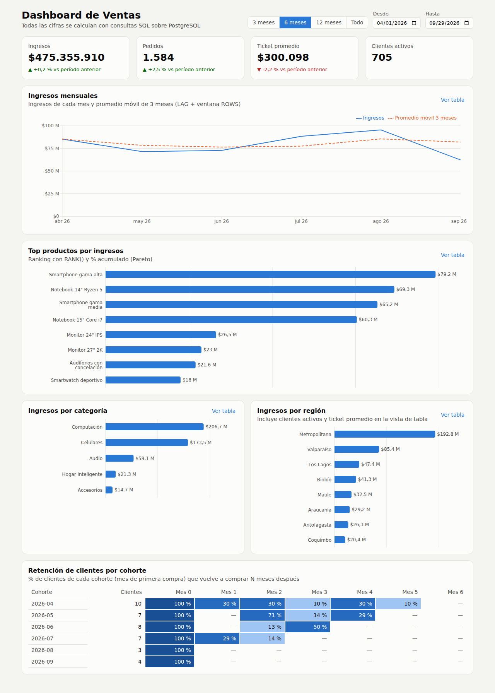
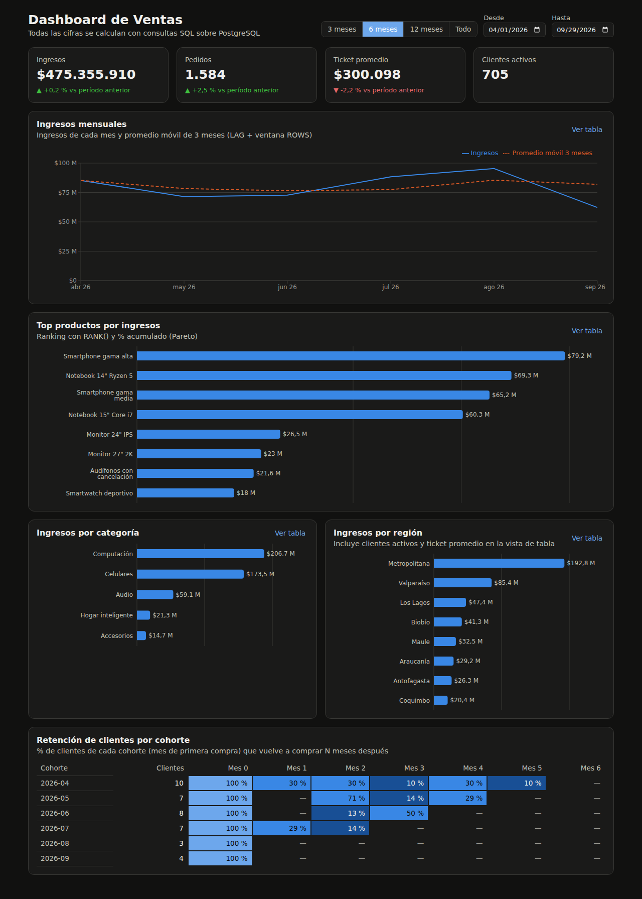
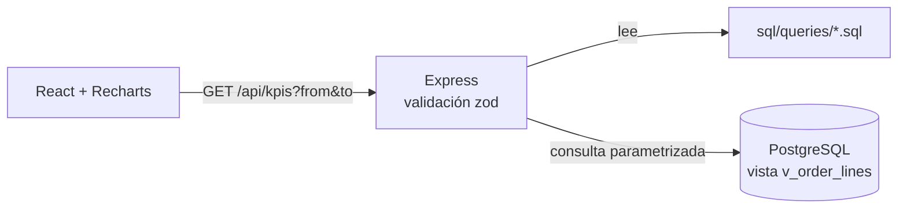
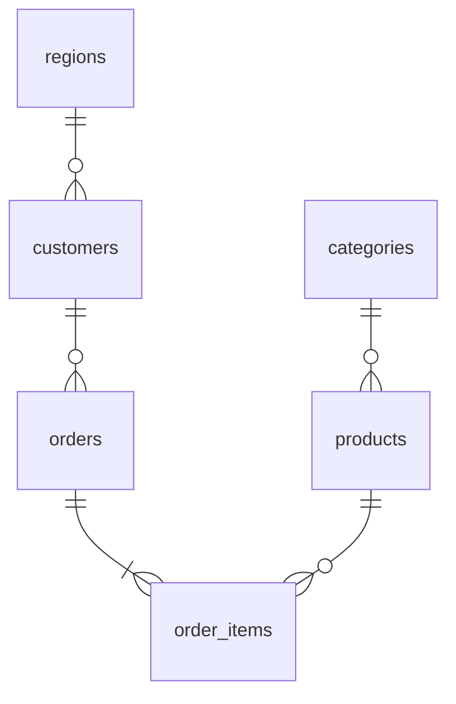

# Dashboard de Ventas con SQL

[](https://github.com/jsonmunoz-dev/dashboard-ventas-sql/actions/workflows/ci.yml)


[](LICENSE)

Dashboard analítico de ventas donde **toda la lógica de negocio vive en SQL**: KPIs comparados con el período anterior, tendencia mensual, análisis de Pareto, ventas por categoría y región, y retención de clientes por cohortes.
La API en Node.js solo valida los parámetros y ejecuta las consultas. El frontend en React muestra los resultados.



<details>
<summary>Ver en modo oscuro</summary>



</details>

## Qué demuestra este proyecto

| Pregunta de negocio                       | Consulta                                                                                                                         | Técnicas SQL                                           |
| ----------------------------------------- | -------------------------------------------------------------------------------------------------------------------------------- | ------------------------------------------------------ |
| ¿Cómo vamos respecto al período anterior? | [`kpis.sql`](sql/queries/kpis.sql)                                                                                               | CTEs, `UNION ALL`, `LEFT JOIN`, `NULLIF`               |
| ¿Cuál es la tendencia mes a mes?          | [`ventas_mensuales.sql`](sql/queries/ventas_mensuales.sql)                                                                       | `generate_series`, `LAG`, promedio móvil con `ROWS`    |
| ¿Qué productos concentran los ingresos?   | [`top_productos.sql`](sql/queries/top_productos.sql)                                                                             | `RANK`, `SUM() OVER ()`, acumulado (Pareto)            |
| ¿Qué categorías y regiones pesan más?     | [`ventas_por_categoria.sql`](sql/queries/ventas_por_categoria.sql), [`ventas_por_region.sql`](sql/queries/ventas_por_region.sql) | `SUM(SUM()) OVER ()`, `COUNT(DISTINCT)`                |
| ¿Los clientes vuelven a comprar?          | [`cohortes.sql`](sql/queries/cohortes.sql)                                                                                       | Análisis de cohortes, `age()`, `FIRST_VALUE`, `WINDOW` |

Además:

- **Modelado**: tablas normalizadas, `CHECK`, claves foráneas y un **índice parcial** (`WHERE status = 'completed'`) pensado para el patrón de consulta.
- **Datos generados con SQL**: [`02_seed.sql`](sql/02_seed.sql) crea unos 5.000 pedidos con tendencia, estacionalidad y productos ponderados por popularidad (muestreo `ORDER BY -ln(random()) / peso`). Los datos son deterministas gracias a `setseed`.
- **Las cifras cuadran**: los tests de integración comprueban que la suma mensual, por categoría y por región dé exactamente el ingreso del KPI, que las participaciones sumen 100 %, que el Pareto llegue a 100 % y que el mes 0 de cada cohorte sea 100 %.

### Ejemplo: promedio móvil y variación mensual

```sql
SELECT to_char(month, 'YYYY-MM') AS month,
       revenue,
       ROUND(100.0 * (revenue - LAG(revenue) OVER w) / NULLIF(LAG(revenue) OVER w, 0), 1)
         AS mom_change_pct,
       ROUND(AVG(revenue) OVER (w ROWS BETWEEN 2 PRECEDING AND CURRENT ROW))
         AS moving_avg_3m
FROM filled
WINDOW w AS (ORDER BY month)
ORDER BY month;
```

## Arquitectura



Las consultas están en archivos `.sql`, no en strings dentro de JavaScript, así que se pueden leer, revisar y ejecutar directamente en `psql`.
La API las asocia a cada ruta en un mapa declarativo ([`server/src/endpoints.js`](server/src/endpoints.js)).



```
├── sql/
│   ├── 01_schema.sql     # tablas, restricciones, índices
│   ├── 02_seed.sql       # generador de datos
│   ├── 03_views.sql      # vista base de análisis
│   └── queries/          # una consulta por métrica del dashboard
├── server/               # Express: valida parámetros y ejecuta las consultas
├── client/               # React + Vite + Recharts
└── docker-compose.yml
```

## Cómo ejecutarlo

### Con Docker

```bash
docker compose up --build
```

Abre http://localhost:8080. PostgreSQL ejecuta los scripts de `sql/` automáticamente la primera vez que se crea la base.

### Local

Requisitos: Node.js 20.19+ y PostgreSQL 14+.

```bash
# Base de datos
cd server
cp ../.env.example .env        # ajusta DATABASE_URL
npm install
npm run db:setup               # o: psql -f ../sql/01_schema.sql -f ../sql/02_seed.sql -f ../sql/03_views.sql
npm run dev                    # API en http://localhost:4100

# Frontend (en otra terminal)
cd client
npm install
npm run dev                    # http://localhost:5173
```

## API

Todas las rutas aceptan `from` y `to` (`YYYY-MM-DD`, máximo 3 años de rango), excepto `/api/rango-fechas`.

| Ruta                            | Parámetros extra | Devuelve                                                |
| ------------------------------- | ---------------- | ------------------------------------------------------- |
| `GET /api/rango-fechas`         |                  | Primera y última fecha con datos                        |
| `GET /api/kpis`                 |                  | Ingresos, pedidos, ticket y clientes + período anterior |
| `GET /api/ventas-mensuales`     |                  | Serie mensual con variación y promedio móvil            |
| `GET /api/top-productos`        | `limit` (1–50)   | Ranking, participación y % acumulado                    |
| `GET /api/ventas-por-categoria` |                  | Ingresos, unidades y participación                      |
| `GET /api/ventas-por-region`    |                  | Ingresos, pedidos, clientes y ticket promedio           |
| `GET /api/cohortes`             | `months` (0–12)  | Retención por cohorte y mes                             |

## Tests

```bash
cd server && npm test                  # endpoints y validación (sin base de datos)
cd server && npm run test:integration  # consultas reales contra PostgreSQL
cd client && npm test                  # componentes y flujo del dashboard
```

En **GitHub Actions** se corren lint y tests de ambos proyectos, la integración contra PostgreSQL 16 y un smoke test del stack completo con `docker compose` (a través de nginx).

## Decisiones de diseño del dashboard

- Paleta validada para daltonismo y contraste en modo claro y oscuro.
- Las variaciones de los KPI usan **flecha y signo**, no solo color.
- Cada gráfico tiene una **vista de tabla** con los valores exactos.
- Los presets de fechas usan **meses completos**, así el primer mes del gráfico no queda parcial.

## Próximos pasos

- Vistas materializadas con refresco programado para volúmenes grandes.
- `EXPLAIN ANALYZE` documentado para las consultas principales.
- Exportar cada vista a CSV.

## Autor

**Jheyson Muñoz**: estudiante de Analista Programador en INACAP Valparaíso.
[GitHub](https://github.com/jsonmunoz-dev)

## Licencia

[MIT](LICENSE)
